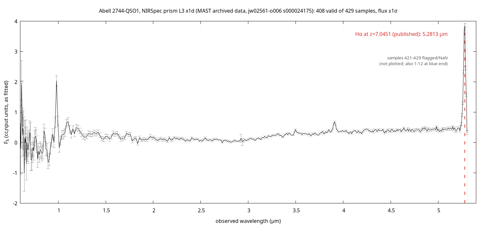
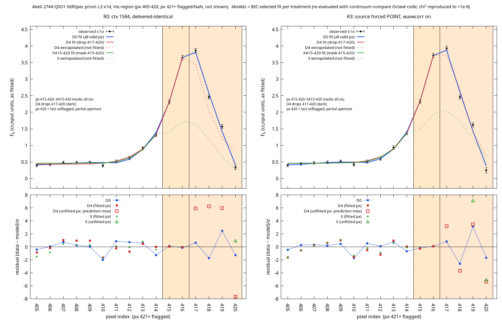

# JWST-LRD

A scientific runtime and verification harness for public James Webb Space Telescope data on Little Red Dots, starting with Abell 2744-QSO1.
It is a multi-language stack (Fortran, C, Futhark, Rust, LLVM, Curry, Self, Agda, Alloy) built so that each numerical claim can be re-checked by an independent path.

Charter:

1. Preserve observations exactly.
2. Verify computations independently.
3. Keep competing explanations alive.
4. Never confuse mathematical proof with empirical discovery.

Status in one line: the software stack builds and most suites pass; **the QSO1 Hα redshift disagrees with the published value by about 0.0029 and that disagreement is unresolved.** Nothing here claims a physical cause.

## Current result: QSO1 redshift from Hα

Data: public MAST level-3 x1d product `jw02561-o006_s000024175_nirspec_clear-prism_x1d.fits` (obsid 230168921, 429 samples, 408 finite, sha256 `c0b87857…5ee7`).



*The full archived spectrum, flux ±1σ, with Hα marked at the published z = 7.0451 (5.2813 µm). Samples 421-429 are flagged NaN and not plotted. Source: the MAST product above.*

Results are stated in three tiers, kept apart on purpose.

**Proven geometry.** Nothing in this tier concerns the observation. A separate Schwarzschild/Kruskal (Einstein-Rosen) derivation with independent checks lives on branch [`gr-derivation`](https://github.com/AHMADALIPARR/jwst-lrd/tree/gr-derivation) (`research/gr-derivation/`). It is not on `main` and is not used for any observational claim below.

**Conditional inference.** Given the pre-registered continuum-model comparison (`research/continuum-compare/`, 20 models = 10 continuum shapes × 1 or 2 line components):
- The Fortran kernel gives z = 7.0405-7.0422 depending on fit choices (`fortran/STATUS.md`; headline 7.04221 ± 0.00027).
- The continuum fits give z = 7.038-7.042 (R0, all valid pixels: BIC-selected 7.040158 ± 0.000497, 20-model range 7.038408-7.042329).
- The published value is z = 7.0451 (Furtak et al. 2024). The gap is about 0.0029, roughly 108 km/s, and about 10× the formal error. It is **unresolved**.

**Observational status (re-reduction with the `jwst` pipeline, 3.0.0).**
- The gap survives alternative calibration contexts: the latest CRDS context gives a reference set identical to the delivered one (1584), and the emulated 1350 and 1200 contexts do not move z toward 7.0451. It also survives the all-pixel and drop-pixel-420 treatments.
- It closes only for one reduction, R3 (source forced to POINT, which turns the wavelength correction on), and only after dropping edge pixels 417-420 (z = 7.0440) or masking 415-420 (z = 7.0433). There the uncertainty is 4-5× larger than for all pixels, model selection is weak, and the Hα peak itself (pixels 416-417) is excluded or partly excluded.
- This is **not** claimed to be physical or gravitational. No cosmology is falsified. Calibration, continuum shape and line profile remain open competing explanations.
- Not assessed: whether the point-source treatment is correct for this source (the pipeline classifies the slit as EXTENDED), the absolute wavelength calibration at the red edge, and partial-aperture flux at pixel 420.


*z(Hα) for each reduction variant (R0 delivered-identical, R1/R2 emulated earlier contexts, R3 forced point source, R4-R7 extraction apertures) under three edge treatments. Dot = BIC-selected model; bar = min-max of the 20 models; red line = published 7.0451. Source: re-reduction of the MAST product above, unchanged pre-registered fits.*

R0 (delivered-identical, ctx 1584) vs R3 (forced point source, wavelength correction on). z is the BIC-selected model; ± is the Δχ² = 1 half-width. D0 = all valid pixels (≤ 420), D1 = drop pixel 420, D4 = drop pixels 417-420, X = mask pixels 415-420.

| Treatment | R0 z | R3 z | R3 − R0 (Δz, km/s) | R0 (7.0451 − z)/hw | R3 (7.0451 − z)/hw | 7.0451 in 20-model range (R0 / R3) |
|---|---|---|---|---|---|---|
| D0 | 7.040158 ± 0.000497 | 7.041052 ± 0.000470 | +0.000894, +33 | 9.94 | 8.61 | out / out |
| D1 | 7.040923 ± 0.000283 | 7.041595 ± 0.000268 | +0.000672, +25 | 14.76 | 13.08 | out / out |
| D4 | 7.038748 ± 0.001887 | 7.044006 ± 0.001847 | +0.005258, +196 | 3.37 | 0.59 | out / in |
| X415-420 | 7.037568 ± 0.002442 | 7.043338 ± 0.001903 | +0.005770, +215 | 3.08 | 0.93 | out / out |

R3 also shifts the Hα pixels by about 0.0005 µm in wavelength, so part of the R3 − R0 offset is a wavelength-calibration difference, not a flux difference. BIC values are not comparable across treatments. The ΔBIC-selected continuum model itself changes with treatment, so these fits do not decide between the competing explanations.



*Hα region, pixels 405-420: data ±1σ, BIC-selected fits for D0, D4 and X415-420, and residuals, for R0 (left) and R3 (right). Pixel 420 is the last unflagged pixel (partial aperture). Source: MAST product above, fitted with `research/continuum-compare/octave`.*


*Per-pixel flux ±1σ and S/N for pixels 410-420, R0 vs R3. Pixel 420 falls from S/N 5.2 (R0) to 3.1 (R3). Source: MAST product above.*

Figure provenance: [`docs/figures/SOURCES.md`](docs/figures/SOURCES.md). The re-reduction run files, plot scripts and the `jwst` environment are **not** in this repository; the tables above are copied from scratch reports outside it and are not reproducible from `main` alone. The pre-registered fits (`research/continuum-compare/`) are in the repository.

## What is on `main`

"Implemented" means the code exists and its own suite passes. "Verified integration" means a documented end-to-end run through several components; see the gaps below.

| Component | Path | Notes |
|---|---|---|
| Archive ingest | `ingest/` | MAST cone search at the Furtak et al. 2023 QSO1 Image A position, SHA-256-addressed raw FITS, LRD-ARR-v1 arrays and LRD-REC-v1 manifests (C, CFITSIO, libcurl), offline replay. Reference assertions print expected counts; the z gate is OPEN |
| Fortran kernel | `fortran/` | Fortran 2018: units, vacuum-air, cosmic time, χ², line centroids, reference analysis of the real spectrum |
| Futhark kernels | `futhark/` | Unit conversion, vacuum-air, z-grid search, diffed against Fortran references |
| Ledger | `ledger/` | Positional Gödel encoding, `LRD_GODEL_MAX_LEN`, prime table cap, strict decode, genesis seq 0; `lrd_state.h` C17/C++17 ABI |
| Hamiltonian engine | `hamiltonian/` | Exact rational arithmetic (GMP), constraint checking, bounded epochs; check order pinned by a mutant that is killed |
| Capability layer | `capability/` | Independent authority process (Rust), RSA accumulator, HMAC-SHA256; `persist_failed` fault injection at all three sites |
| Causal track | `fortran/causal/`, `curry/causal/`, `self/causal/` | Light-cone classification graph (LRD-CAUSAL-GRAPH-v1) with sidecar verification. Cone-vs-causation scope is documented in `fortran/causal/STATUS.md` |
| AIR/STARK | `air/` | C17 STARK-style prover over Goldilocks; conjectured 127 bits, proven 49/74 bits; no zero-knowledge, not audited |
| LLVM compiler | `llvm/`, `abi/` | `lrdc` lowers LRD-IR operations to LLVM; compared with the Fortran results |
| Topology | `fortran/topology/`, `futhark/topology/`, `self/topology/` | Simplicial homology over GF(2), GF(3), GF(5), Q with Merkle commitments |
| Formal models and proofs | `research/alloy/`, `agda/`, `theorems/` | Bounded Alloy models (bounded, not proofs); Agda cores |
| Growth studies | `fortran/growth/`, `curry/growth*/`, `agda/growth/`, `self/growth/`, `haskell/` | Black-hole growth scenarios; see `research/MISSION-QSO1-DCBH-001.md` |
| Continuum comparison | `research/continuum-compare/` | Pre-registered redshift comparison (awk, Octave, Fortran cross-check) |
| MATLAB / SAS | `matlab/`, `sas/` | Licensed products, not installed: always UNAVAILABLE here |

Integration status and the remaining-blocker criteria are in `research/INTEGRATION.md` (an older log, partly stale) and `research/BLOCKERS.md`.

## Verification status

Suite counts below were read this session by running the suites on `main` at `afcdbe4` (America/Los_Angeles, 2026-10-27), unless the last column says otherwise. Every suite prints `PASS` / `FAIL` / `UNAVAILABLE` lines; `OPEN` marks a known unresolved item and is counted separately.

| Suite | PASS | FAIL | UNAVAILABLE | OPEN | Source |
|---|---|---|---|---|---|
| `tests/ledger` | 37 | 0 | 0 | 0 | run this session |
| `tests/hamiltonian` | 42 | 0 | 0 | 0 | run this session |
| `tests/ingest` | 38 | 0 | 0 | 0 | run this session |
| `tests/fortran` | 51 | 0 | 0 | 2 | run this session |
| `tests/capability` | 77 | 0 | 0 | 1 | run this session |
| `tests/repo` (size check) | 4 | 0 | 1 | 0 | run this session |
| `tests/causal` | 285 | 0 | 0 | 0 | `fortran/causal/STATUS.md` (author's run, before later merges); needs PAKCS 3.10.0 and a Self VM; not re-run |
| other suites (`air`, `futhark`, `llvm`, `validation`, `topology`, `agda`, `growth`, `curry-growth`, `self`, `sas`, `matlab`) | UNAVAILABLE | | | | not re-run; see each `*/STATUS.md` |
| whole `tests/run_all.sh` on current `main` | UNAVAILABLE | | | | not run. Last recorded baseline (PR #20, `research/BLOCKERS.md`): 843 PASS / 1 FAIL / 29 UNAVAILABLE |

### Known open items

| Item | State |
|---|---|
| Hα z gate (ingest, `tests/fortran`) | **OPEN**: `OPEN redshift_vs_furtak2024 dz=0.0029` and `FAIL-EXPECTED/OPEN redshift_strict`. Not counted as PASS |
| Capability restart behaviour | **OPEN**: `OPEN persist_failed_consume_site_cap_usable_after_restart` (after a consume-site persist failure the capability is consumed in memory but still `issued` on disk, so it is usable once more after an authority restart; the test asserts it is accepted at most once in total). Fixing it needs a production-code decision |
| `fixtures/raw/` (17.3 MB) | Decision pending: keep tracked, or move to a fetch script / release asset. `tests/repo` reports `UNAVAILABLE tracked_size_lt_15MB` until then |
| Git history size | Build artifacts were untracked at the tip only (tracked size 216.9 MB → 25.1 MB, PR #29); `.git` is still about 82 MB. A history rewrite is **not authorized** |
| `cg.scope_only_own_dirs` (`tests/curry-growth`) | Reported FAIL by the maintainers; **not verified here** (needs PAKCS; the committed evidence in `tests/curry-growth/evidence/run_sh.out` shows PASS for an earlier branch state) |
| 29 UNAVAILABLE | From the last recorded full-suite baseline (see above); not re-counted. They are missing or licensed tools (MATLAB, SAS) and unavailable inputs |
| Verified end-to-end integration | Not established: INTEGRATION.md lists "real-fixture end-to-end" and "exact build commands" as not done |
| Alloy / Lean reviews | Pending in places; Alloy checks are bounded |

## Build and test

```sh
git clone https://github.com/AHMADALIPARR/jwst-lrd.git && cd jwst-lrd
make toolchain      # detect tools, write build/TOOLCHAIN.lock
make build          # C ingest tools and the Fortran kernel
make fixtures       # verify sha256 of the raw FITS fixtures (re-fetches from MAST if missing)
make test           # tests/run_all.sh: every tests/*/run.sh
bash tests/ledger/run.sh   # or one suite at a time
```

Toolchain: gcc and gfortran, clang and LLVM, Futhark, GMP, cfitsio, libcurl, OpenSSL, Rust (capability authority only), Alloy 6, and for some suites PAKCS (Curry), a Self VM and Agda. Pinned versions are in `build/TOOLCHAIN.lock`. A suite whose tool is missing prints `UNAVAILABLE`; that is not a PASS.

## Repository map

| Path | Contents |
|---|---|
| `research/CONTRACTS.md` | File formats (LRD-ARR-v1, LRD-REC-v1, LRD-STATE-v1) and the charter |
| `research/BLOCKERS.md` | Resolution criteria for the five blockers (a ledger, b Hamiltonian, c capability, d ingest, e build artifacts) |
| `research/INTEGRATION.md` | Older integration log (stale in places) |
| `research/continuum-compare/` | Pre-registered continuum comparison for z(Hα) |
| `research/BLIND-PROTOCOL.md`, `research/MISSION-QSO1-DCBH-001.md`, `research/CITATIONS.md` | Blind-analysis protocol, growth-history mission, retrieved papers |
| `docs/figures/` | Figures used in this README, with `SOURCES.md` |
| `research/assets/` | Illustrations, not data |
| `ingest/`, `fortran/`, `futhark/`, `ledger/`, `hamiltonian/`, `capability/`, `air/`, `llvm/`, `agda/`, `curry/`, `self/`, `haskell/` | Components, each with a `STATUS.md` where it has one |
| `tests/` | One `run.sh` per suite; `tests/run_all.sh` aggregates |
| `fixtures/` | Raw MAST products (sha256-pinned), reference outputs |
| `build/` | Toolchain scripts and lock only; build output is untracked |

Other branches: `gr-derivation` (geometry derivation), `gh-pages` (observed-spectrum page).

## Licence

AGPL-3.0-only, together with the SnapKitty Opaque License (see `LICENSE` and `SNAPKITTY_OPAQUE_LICENSE.md`). The dual licensing is intentional.
