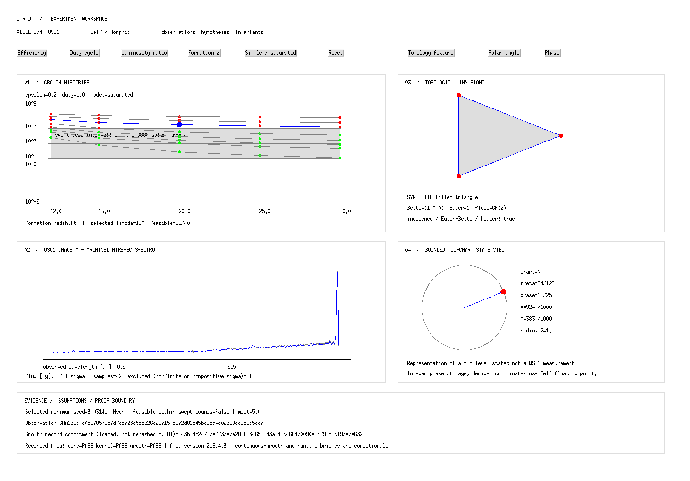

# Observations. Hypotheses. Invariants.

## [Open the live Self / Morphic route →](live/)

On the NUC, this route embeds the running native renderer: archived waveform,
animated helix, phase wave and red-dot state. It connects only to localhost;
allow this-device access if the browser asks. The controls operate the Self
process, and no public remote-control tunnel is enabled.

Explore the Abell 2744-QSO1 experiment through its native **Self / Morphic**
workspace: archived JWST spectra, growth histories, topology and bounded
state projection, with explicit provenance and proof boundaries.

[Source and run instructions](https://github.com/AHMADALIPARR/jwst-lrd/tree/frontend/morphic-workspace/self/experiment)
· [Repository](https://github.com/AHMADALIPARR/jwst-lrd)
· [Agda obligations](https://github.com/AHMADALIPARR/jwst-lrd/blob/frontend/morphic-workspace/agda/OBLIGATIONS.md)

## The experiment workspace


This is an actual rendered Self/Morphic session. Use the [live route](live/)
for the running animation on the NUC. The records below document the earlier
growth/topology workspace and its verification.

| View | What it shows |
|---|---|
| Growth histories | All 1,200 parameter combinations; simple and saturated models; selected seed mass and feasibility |
| NIRSpec spectrum | 429 archived samples of QSO1 Image A, observed wavelength, flux and one-sigma errors |
| Topological invariant | Explicitly synthetic complexes, committed Betti numbers, incidence checks and Euler–Betti equality |
| State projection | Quantized polar/phase controls and a bounded two-chart Bloch atlas |
| Evidence | Observation hash, growth commitment, selected values and recorded Agda results |

## Change the hypothesis, preserve the observation



The controls change the view model. Observation arrays and canonical fixture
records retain their committed bytes. Synthetic topology is labeled as such;
the state projection is a representation rather than a QSO1 measurement.

## Executed verification

The NUC/WSL validation completed **27 checks**, including:

- Agda `Core.All`, `Kernel.Everything` and `Growth`, checked with
  **Agda 2.6.4.3 / stdlib 2.1**, `--safe --without-K`.
- Rejection of an intentionally false growth certificate.
- All 1,200 growth selectors and all 33,024 quantized projection states.
- Binary64 reading, observation provenance and four synthetic topology cases.
- Native world rendering, a real mouse-button event and view updates.

[Proof results](proof-results.txt) · [Model results](model-results.txt)

The live companion additionally passes eight transport checks: fresh native
frames, invalid-token and arbitrary-action rejection, allowlisted Self message
delivery, changing stream frames, pause, phase changes while paused, and resume.
[Live transport results](https://github.com/AHMADALIPARR/jwst-lrd/blob/frontend/morphic-workspace/tests/morphic/evidence/live-results.txt)

The mathematical growth certificate is a conservative sufficient bound:
9,000 solar masses under its stated benchmark and continuous-growth bridge.
It is not the numerical minimum or a measured seed mass. Cryptographic
binding and deployed runtime refinement remain explicit assumptions.
No physical quantum apparatus or independent dynamical-mass reconstruction
is established by this interface.

## Run Self / Morphic

Use the existing language stack and an X11-enabled Self VM on Linux/WSL.
The project adds no browser programming language or JavaScript application.

```sh
export SELF_BIN=/absolute/path/to/Self
export SELF_OBJECTS=/absolute/path/to/self/objects
export LRD_AGDA=/absolute/path/to/agda
export LRD_AGDA_STDLIB=/absolute/path/to/agda-stdlib/src
sh tests/morphic/run.sh
```

For an interactive session, follow the
[workspace guide](https://github.com/AHMADALIPARR/jwst-lrd/blob/frontend/morphic-workspace/self/experiment/README.md).
Validated implementation: commit
[`78d967c`](https://github.com/AHMADALIPARR/jwst-lrd/commit/78d967c).

---

Preserve observations exactly. Verify computations independently. Keep
competing explanations alive. Never confuse mathematical proof with
empirical discovery.

[Licensing](https://github.com/AHMADALIPARR/jwst-lrd/blob/main/LICENSE)
· [SnapKitty Opaque License](https://github.com/AHMADALIPARR/jwst-lrd/blob/main/SNAPKITTY_OPAQUE_LICENSE.md)
