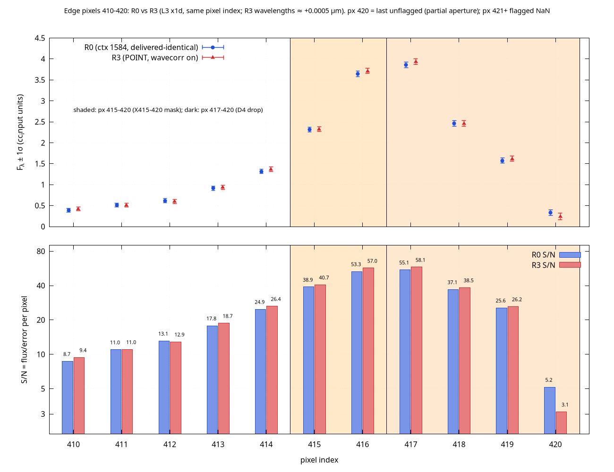
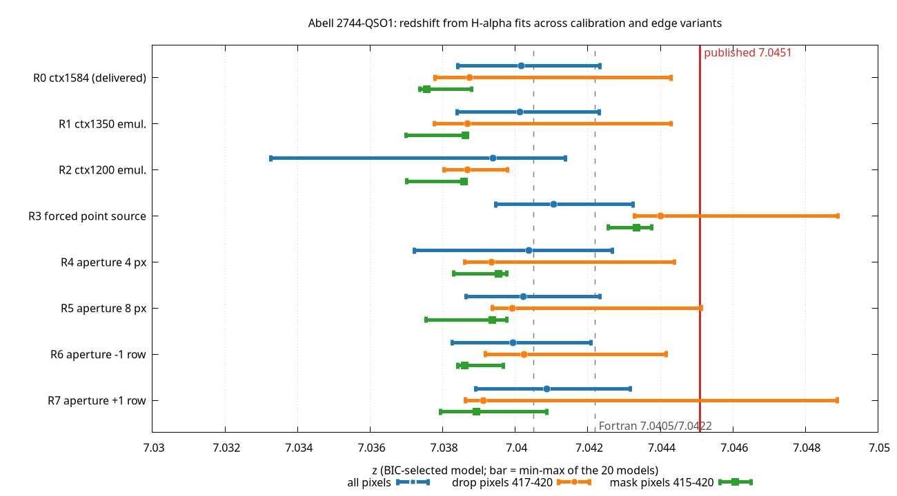

# QSO1 — Observed JWST spectrum and fits

**Abell 2744-QSO1, archived NIRSpec prism data.** This page shows archived
products from the public MAST archive. It is not live telescope telemetry; no
live feed exists. Figures below are plots of the archived spectrum and of fits
to it, produced with gnuplot and GNU Octave (not MATLAB).

## Source data

- NIRSpec prism spectrum of QSO1: program jw02561, observation 006, source 24175, obsid 230168921.
- File: `jw02561-o006_s000024175_nirspec_clear-prism_x1d.fits` (MAST level-3 x1d), 429 archived samples.
- 408 samples (indices 13–420) carry finite values; samples 1–12 and 421–429 are NaN/flagged and are not plotted.

*Archived data: flux ± 1σ for the 408 finite samples against observed wavelength. Flux is in the units of the fitting input table (F_λ, as fitted). The dashed red line marks Hα at the published z = 7.0451.*

## Hα region and fits

R0 is the reduction matching the delivered products (CRDS context 1584). R3
forces the source to be treated as a point source with the wavelength
correction on. Treatments: D0 uses all valid pixels (up to 420); D4 drops
pixels 417–420; X415-420 masks pixels 415–420. Redshift z is from the
BIC-selected model; ± is the Δχ² = 1 half-width (unscaled). Published z = 7.0451.

| Reduction | Treatment | z_sel ± half-width | BIC | Centroid shift vs R0-D0 (km/s) | (7.0451 − z)/half-width |
|---|---|---|---|---|---|
| R0 | D0 | 7.040158 ± 0.000497 | 86.85 | 0 | 9.94 |
| R0 | D4 | 7.038748 ± 0.001887 | 56.51 | −53 | 3.37 |
| R0 | X415-420 | 7.037568 ± 0.002442 | 47.08 | −97 | 3.08 |
| R3 | D0 | 7.041052 ± 0.000470 | 90.79 | +33 | 8.61 |
| R3 | D4 | 7.044006 ± 0.001847 | 52.59 | +143 | 0.59 |
| R3 | X415-420 | 7.043338 ± 0.001903 | 43.20 | +119 | 0.93 |

BIC values are not comparable across treatments because the number of pixels differs.

R3 − R0 for the same treatment:

| Treatment | Δz | Δv (km/s) |
|---|---|---|
| D0 | +0.000894 | +33 |
| D4 | +0.005258 | +196 |
| X415-420 | +0.005770 | +215 |

Part of the R3 − R0 offset is a wavelength-calibration difference: R3 wavecorr
shifts the Hα pixels by about 0.0005 µm.

## Status

- Fits of the Hα line give z ≈ 7.038–7.042 when all pixels are used. The published value is 7.0451. The gap of about 0.0029 in z (about 108 km/s) is unresolved.
- In these fits, agreement with 7.0451 appears only for the forced point-source variant (R3) after excluding edge pixels 417–420 or 415–420, at roughly 4–5 times larger uncertainty.
- This does not establish a physical or gravitational cause, and it does not falsify any cosmology.
- Competing explanations remain open: calibration, continuum shape and line profile.
- Not assessed: whether the point-source treatment is correct for this source, the absolute wavelength calibration at the red edge, and the partial-aperture flux at pixel 420.

## Provenance

- Data file: `jw02561-o006_s000024175_nirspec_clear-prism_x1d.fits`, 6,347,520 bytes, retrieved from MAST 2026-10-27, sha256 `c0b878576d7d7ec723c5ee526d29715fb672d81e45bc8ba4e02598ce8b9c5ee7`.
- Association file `jw02561-o006_20260924t054121_spec3_00001_asn.json`, sha256 `ab87e9e51f297a1e195b01662b7cfa000f2522cd0dcfc511cc213daa8ca46d6f`.
- Tools: jwst 3.0.0, CRDS context 1584, gnuplot 6.0, GNU Octave 9.4.0 (Octave, not MATLAB). The full-spectrum figure was plotted with gnuplot from the fitting input table `cc_input.tsv`, which was derived from the x1d file above.
- Repository: [AHMADALIPARR/jwst-lrd](https://github.com/AHMADALIPARR/jwst-lrd) · [Back to the main page](../)

---

[Licensing](https://github.com/AHMADALIPARR/jwst-lrd/blob/main/LICENSE)
· [SnapKitty Opaque License](https://github.com/AHMADALIPARR/jwst-lrd/blob/main/SNAPKITTY_OPAQUE_LICENSE.md)
