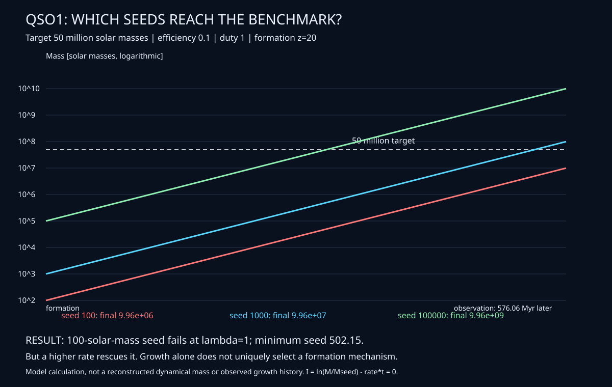

<!-- SPDX-License-Identifier: AGPL-3.0-only AND LicenseRef-SnapKitty-Opaque -->
# QSO1: what the implemented invariants actually constrain

The earlier red-dot/helix video illustrated a state representation. It did
not derive QSO1 morphology or a scientific conclusion. In particular, no
implemented mapping takes the observed spectrum to that helix. The relevant
scientific question here is whether growth constraints select a seed history.

## Computed result

Declare Mtarget=50,000,000 solar masses, zobs=7.04221, zform=20,
epsilon=0.1, duty=1 and luminosity ratio lambda=1. The repository's flat
matter+Lambda cosmology uses H0=67.36, Om=.3153, Ol=.6847 and neglects
radiation. The target is a published benchmark input; this analysis does
not independently measure it from kinematics.

| Calculation | Result |
|---|---:|
| Time available | 576.058867350 Myr |
| Minimum seed, numerical continuous model | 502.149751046 solar masses |
| Final mass from 100 solar masses | 9,957,189.043827 solar masses |
| Final mass from 1,000 solar masses | 99,571,890.448693 solar masses |
| Lambda needed by a 100-solar-mass seed, simple model | 1.140218902844 |
| Lambda needed by that seed, saturation prescription | 1.150525624625 |
| Minimum seed at duty 0.5, otherwise same tuple | 158,453.423921 solar masses |
| Minimum seed at duty 0.25, otherwise same tuple | 2,814,723.999978 solar masses |

**Conclusion:** the 100-solar-mass seed fails for the benchmark Eddington
history, but a computed modestly higher rate rescues it. Growth constraints
alone do not uniquely require heavy-seed or primordial formation. These
are model counterexamples, not evidence that the higher-rate history occurred
or satisfies additional gas-supply, feedback and luminosity constraints.

## Invariants located in the source

| Invariant | Source | Role in this result |
|---|---|---|
| `seed * factor` increases with seed | `agda/growth/Growth.agda`, `grow-mono` | A seed threshold orders the allowed and excluded histories for a fixed factor. |
| No mass loss for nonnegative seeds and step >= 1 | same, `grow-no-loss` | Consistency constraint for an accretion-only trajectory. |
| Epoch composition is associative | same, `grow-compose`, `pow-add` | Splitting a constant-rate growth history cannot change its exact rational-model endpoint. |
| Larger allowed per-step multiplier increases growth | same, `factor-mono` | Explains how changing accretion assumptions changes exclusions. |
| Certified lower factor gives a sufficient seed bound | same, `sufficient`, `Benchmark.cert` | The 9,000-solar-mass rational certificate remains a separate conservative bound, conditional on A-GR-1 for continuous interpretation. |
| `I(t)=ln(M(t)/Mseed)-rate*t=0` | `fortran/growth/src/lrd_growth.f90` model; independently tested in `self/experiment/transport/growth_result.c` | Numerical trajectory check at every RK4 step. It is not a new Agda real-analysis theorem. |
| Boundary of a boundary vanishes over integer chains | `agda/Kernel/src/Kernel/Simplicial.agda` | Mathematical topology; the demo's synthetic complexes have not been inferred from JWST data. |
| Accepted Hamiltonian energy does not increase; strict descent terminates | `agda/Kernel/src/Kernel/Hamiltonian.agda` | Runtime guard invariant; not a physical black-hole Hamiltonian or an observational fit. |
| Observation payload preservation, accepted-state/sequence/capability constraints | `agda/Core`, `agda/Kernel/src/Kernel` | Integrity of the modeled runtime; deployed fidelity and cryptographic binding have explicit assumptions. |

## Why the origin is not identifiable here

For a constant-rate history,

`ln(Mtarget/Mseed) = duty * ((1-epsilon)/epsilon) * lambda_eff * Delta_t/tEdd`.

The endpoint constrains this combination, not its individual components.
In the simple prescription, duty=1/lambda=1 and duty=0.5/lambda=2
give exactly the same rate and entire mass history for the same seed.
In the saturation prescription, the second pair is duty=0.5/lambda=e.
The test executes both examples. Changing seed and compensating the rate
gives additional endpoint degeneracy, as the 100-solar-mass example shows.

## Independent verification

Run `sh tests/morphic/results.sh` in the existing C/shell environment.
It does not install packages, modify observations or regenerate fixtures.

- An analytic asinh cosmological clock, rather than the Fortran numerical
  quadrature, reproduces all 1,200 stored Fortran rows in both prescriptions.
  Maximum relative seed difference: 4.76011063899e-9 (CSV precision limited).
- A separate 2,000-step RK4 trajectory has maximum log-invariant residual
  1.04646957766e-10. This is an observed numerical residual, not a rigorous
  floating-point interval bound.
- Both higher-rate light-seed counterexamples reach the declared target.
- The two prescriptions change 82 grid feasibility labels. Grid counts are
  not posterior probabilities and are not fractions of real galaxies.
- Corrupting a stored seed by ten percent and removing a row are rejected.

The C calculation uses CODATA constants and an analytic constant-rate solution;
it compares against committed Fortran results rather than pretending the
Fortran compiler ran. The current environment has no `gfortran` executable.
The Self live panel computes selected endpoints and exclusions from the
committed full-precision records; changing a selector updates the result.

## What would establish a stronger scientific conclusion

Reconstruct the dynamical mass with uncertainty from lensing/kinematics,
constrain efficiency, duty and luminosity histories with independent data,
impose gas and feedback bounds, and compare the competing scenarios using
a stated likelihood. The current one-dimensional integrated spectrum and
synthetic topology do not supply these constraints. Neither a physical
helix nor a primordial origin follows from this result.

The source observation and target provenance are documented in
`research/CITATIONS.md` and `research/MISSION-QSO1-DCBH-001.md`.
Independent guardian review remains outstanding.
