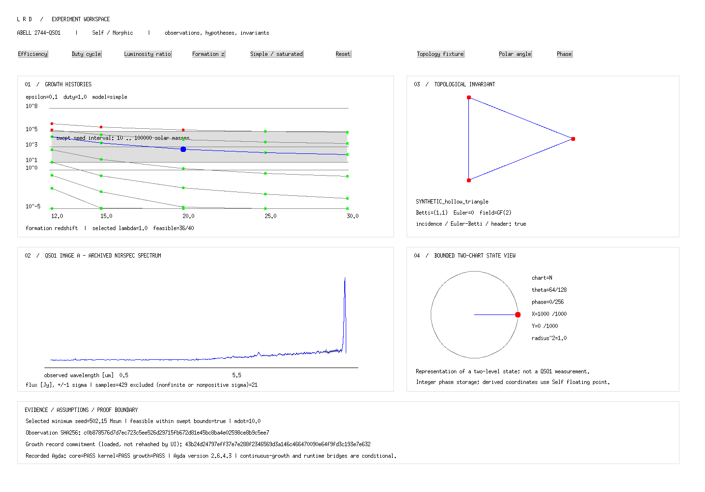

<!-- SPDX-License-Identifier: AGPL-3.0-only AND LicenseRef-SnapKitty-Opaque -->
# Little Red Dots experiment workspace

## Standalone 2D demo

The `/jwst-lrd/demo/` route plays a 30-second MP4 without the VM. Self exports
720 vector frames at 24 fps, including smooth camera moves into the red-dot
state, helix, phase wave and archived spectrum. The 1080p video and 4K master
are independently rasterized from those vectors; the 4K version is not a
bitmap upscale. Separate SVG detail views preserve subpixel geometry for zoom.

```sh
SELF_BIN=/path/to/Self SELF_OBJECTS=/path/to/self/objects \
  sh self/experiment/transport/demo.sh
```

Outputs are written under `build/out/demo/`: two MP4 files, detail SVGs,
poster, FFprobe metadata, decode logs and SHA-256 sums. Native Self is required
only to regenerate the geometry; viewing the finished media needs no VM.
The exporter retains floating-point coordinates until vector rasterization.
The model nucleus/helix/wave are illustrative, and the archived spectral
samples are observational. A geometry zoom does not increase JWST resolution.

## Live browser route

`/jwst-lrd/live/` embeds a running Self/Morphic process on the NUC through
`http://127.0.0.1:8765/live/`. Browser controls send allowlisted messages to
that process; native Self draws the archived spectrum, animated phase wave,
double helix and red-dot state. The helix and nucleus are illustrative model
geometry, not a resolved observation or inferred JWST time signal.

The browser may ask to connect to this device. Allow that permission on the
NUC. The route is local-only: other visitors need their own running renderer.
No public tunnel or administrative endpoint is enabled.

```sh
SELF_BIN=/path/to/Self SELF_OBJECTS=/path/to/self/objects \
  sh self/experiment/transport/start.sh
sh tests/morphic/live.sh
```

The transport uses the existing C and shell stack plus FFmpeg/Xvfb tools.
It streams native frames at eight frames per second, with no JavaScript
renderer or rewritten model. It accepts nine constant experiment commands;
it exposes no arbitrary Self evaluation, shell, file upload or desktop input.
The companion process must remain running. The session directory and PIDs
are recorded under `build/out/live/` for operator inspection.

A native Self/Morphic workspace for Abell 2744-QSO1. It uses the existing
Self VM, ui2 controls, solver records and topology exports. No web framework,
new language or background service is added.



## Explore

- **Growth:** all six efficiencies, five duty cycles, eight luminosity ratios
  and five formation redshifts; simple and saturated models. Blue selects a
  luminosity-ratio curve and row; green/red mark feasibility within the
  swept seed interval. The base-10 log axis clips values to 10^-5..10^8 for
  display; the selected value remains unchanged.
- **Spectrum:** 429 archived binary64 samples in observed micrometres and Jy,
  with one-sigma error bars. Nonfinite samples and nonpositive errors are
  counted and excluded from drawing. Arrays are never rewritten; this does
  not create a new scientific mask. Units and source hashes must agree.
- **Topology:** four explicitly synthetic exports with vertices, edges,
  filled faces, committed Betti numbers and coefficient fields. Incidence
  symmetry, Euler–Betti equality and header/root metadata consistency are
  checked. The UI does not recompute homology or equate these shapes with
  observed QSO1 geometry.
- **State projection:** quantized polar/phase controls in the bounded
  two-chart Bloch atlas. All 33,024 quantized states are tested against a
  radius-squared tolerance of 10^-5. This is a state representation, not an
  astronomical measurement or a quantum-hardware backend.
- **Evidence:** selected seed, accretion rate, observation hash, loaded growth
  commitment and recorded Agda results. The UI does not rehash commitments
  or rerun proofs. Refresh reports after changing proofs; proofs.rec records
  the checked source-tree hash (canonical LF text for portability across
  Windows checkouts). Conditional theorems remain conditional.

Buttons change only the view model. They never modify observations or append
ledger transitions. Target mass is a declared benchmark input; independent
dynamical-mass reconstruction remains a separate mission task.

## Run and verify

Use an X11-enabled 32-bit x86 Self VM, matching objects tree, Agda 2.6.4.3
and stdlib 2.1. Xvfb and ImageMagick support automated screenshots; xdotool
also tests an actual mouse click.

```sh
export SELF_BIN=/absolute/path/to/Self
export SELF_OBJECTS=/absolute/path/to/self/objects
export LRD_AGDA=/absolute/path/to/agda
export LRD_AGDA_STDLIB=/absolute/path/to/agda-stdlib/src
sh tests/morphic/run.sh
```

The suite checks three proof aggregates, rejects a false certificate, tests
all growth selectors and binary64 decoding, sweeps the projection atlas,
opens Morphic, exercises controls and captures initial/changed states.
Missing tools print UNAVAILABLE. Logs go to build/out or the evidence
directory; concise results and screenshots are included in the branch.

For an interactive local X display:

```sh
cd "$SELF_OBJECTS"
LRD_ROOT=/absolute/path/to/jwst-lrd "$SELF_BIN" \
  -f worldBuilder.self -b . -o morphic \
  -f2 /absolute/path/to/jwst-lrd/self/experiment/load.self
```

At the Self prompt, evaluate `lrdWorkspace open`. Keep DISPLAY set to your
local X server. Some Windows drvfs inode numbers fail in the VM's 32-bit
file API; use an ext4 checkout in WSL. Automated tests stage exact checkout
bytes on ext4. Git attributes preserve length-prefixed fixture bytes.

## Proof boundary

Core.All, Kernel.Everything and Growth are checked with safe termination and
without K. Growth-to-continuous-solver refinement, cryptographic binding and
deployment fidelity remain explicit assumptions. Mathematical checking cannot
prove a telescope measured a particular mass. See the
[growth proof status](../../agda/growth/STATUS.md).
